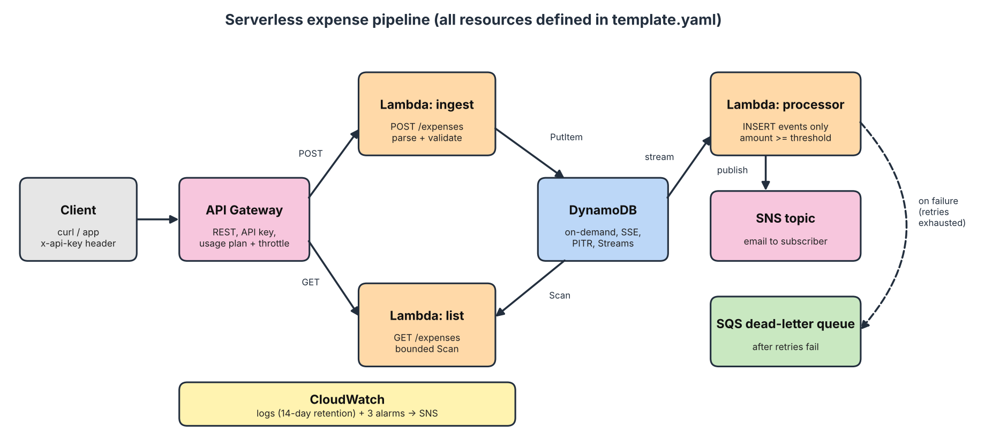

# Serverless Expense Pipeline (AWS)


CS 79C final project: an event-driven expense tracker built entirely from AWS managed services and defined in CloudFormation. It is a rebuild of an earlier n8n "Expense Tracker Agent" lab, replacing the chat agent with an authenticated REST API, deterministic schema validation, and an event-driven alerting pipeline.



## What It Does

1. A client submits a `POST /expenses` request containing either natural English text (`"I spent $45 on office supplies yesterday."`) or structured JSON.
2. **Amazon API Gateway** validates the required `x-api-key` header, enforces rate limits via a dedicated usage plan, and invokes the **Ingest Lambda**.
3. The **Ingest Lambda** parses the input and runs schema validation. If required fields are absent or invalid, it returns `HTTP 400` with descriptive error details and halts execution without writing to storage.
4. Validated expense records are saved directly to an encrypted **Amazon DynamoDB** table using on-demand capacity.
5. **DynamoDB Streams** triggers the **Processor Lambda** asynchronously on each `INSERT` event. If the expense amount meets or exceeds the review threshold ($500), it publishes an alert notification via **Amazon SNS**.
6. If the processor experiences transient or unhandled exceptions, records are retried twice with batch splitting before routing to an **Amazon SQS Dead-Letter Queue (DLQ)**. **Amazon CloudWatch** monitors Lambda invocation errors and DLQ depth, dispatching alarm notices via SNS.

Every successful response includes `"submitted_by": "Mukwaya Lwere"` to confirm deployment identity.

## AWS Services & Architecture Rationale

| Service | Role in Solution | Rejected Alternative | Why Alternative Was Rejected |
| :--- | :--- | :--- | :--- |
| **API Gateway** | REST API endpoints, key enforcement, rate limiting | Application Load Balancer (ALB) | ALB carries fixed hourly costs (~$16+/mo) even when idle, while API Gateway is serverless and pay-per-request. |
| **AWS Lambda** | Ingestion, listing, and stream processing compute | Amazon ECS / Fargate | ECS requires ongoing container tasks and cluster overhead; Lambda scales to zero with no idle compute billing. |
| **Amazon DynamoDB** | Schemaless persistent operational storage | Amazon RDS (PostgreSQL/MySQL) | RDS requires provisioned instances and continuous connection pool management; DynamoDB offers native event stream integration and zero baseline cost on-demand. |
| **Amazon SNS** | Operational email alerts for flagged expenses | Amazon SES | SES requires domain validation (DKIM/SPF) and sandbox lifting; SNS provides immediate multi-subscriber notification topics out of the box. |
| **Amazon SQS** | Dead-letter queue (DLQ) for failed stream batches | Amazon Kinesis Data Streams | Kinesis requires provisioned shard hours and dedicated stream management; SQS DLQ scales transparently with zero idle charges. |
| **CloudWatch** | 14-day retained logging, metrics, alarm triggers | Third-party APM (Datadog) | CloudWatch provides native integration with Lambda, API Gateway, and CloudFormation without third-party agent licensing fees. |

## Repository Layout

```text
template.yaml            CloudFormation (SAM) template defining all infrastructure
src/ingest/              POST /expenses handler + NLP/regex expense_parser.py
src/list_expenses/       GET /expenses handler (bounded Scan)
src/processor/           DynamoDB Streams consumer that evaluates thresholds & publishes alerts
tests/                   17 unit tests for parser and handlers (no AWS connection required)
deploy.sh                Packaging and CloudFormation deployment script
scripts/                 get_config.sh, smoke_test.sh, cleanup.sh
docs/                    architecture.png, design-decisions.md, well-architected-review.md
.github/workflows/ci.yml GitHub Actions workflow running pytest and cfn-lint
